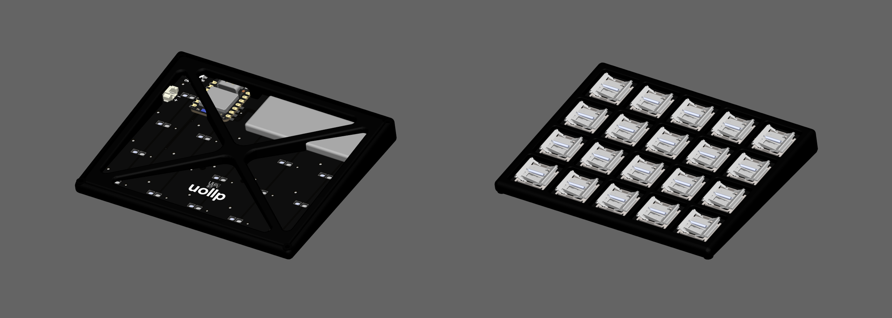
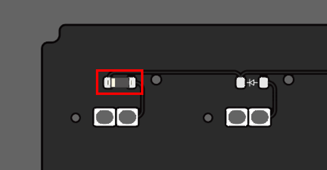
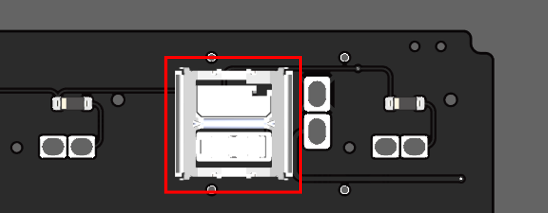
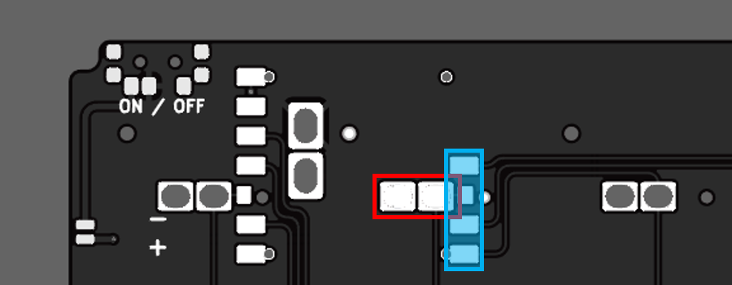
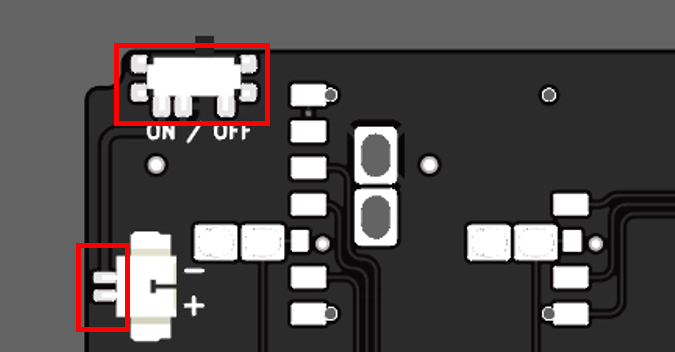
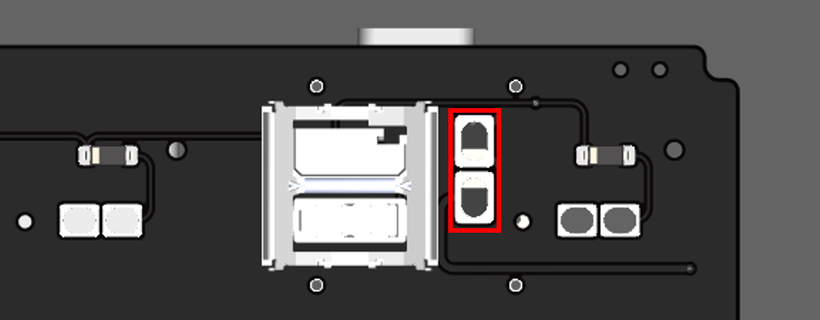
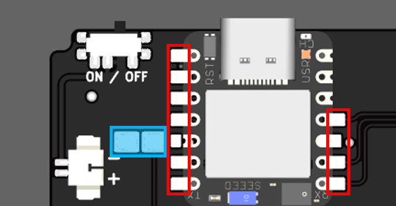
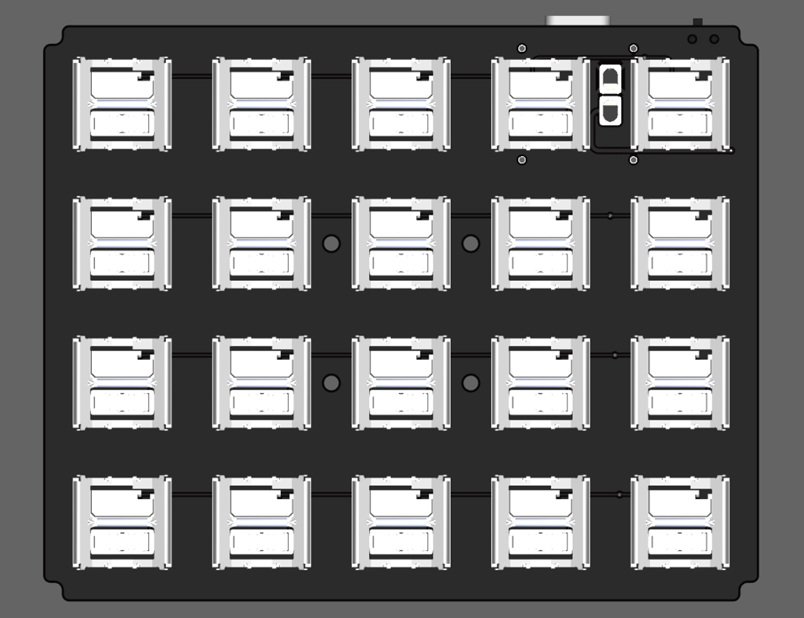
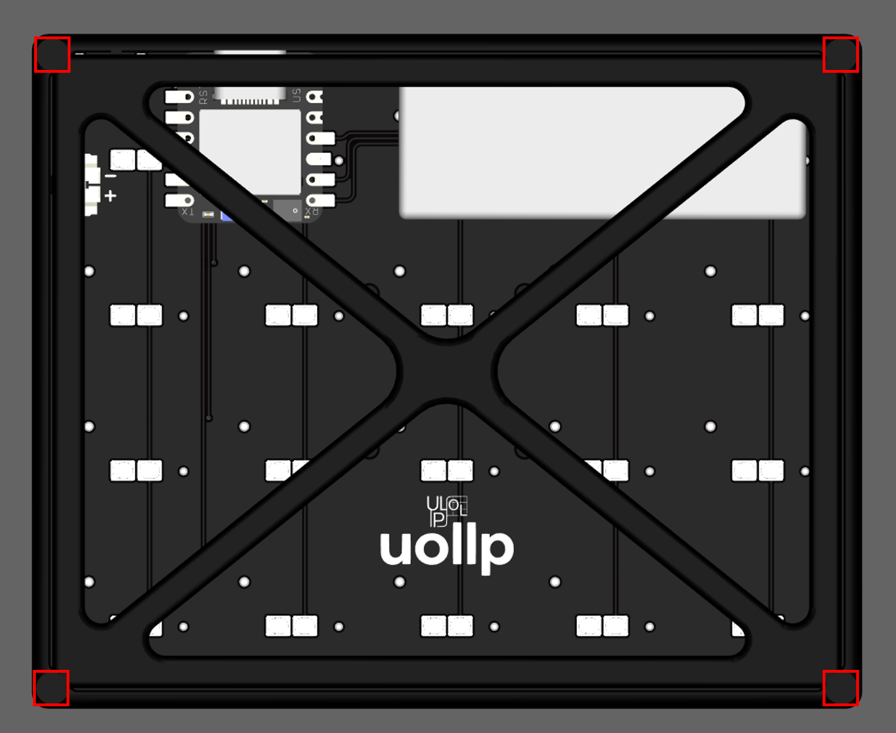

# uollp - UltraLowProfile x Ortholinear
uollp はウルトラロープロファイル x オーソリニアの自作キーボードです。

> [!CAUTION]
> このビルドガイドは、ある程度自作キーボードの作成に慣れている方向けの粒度で記載しています。
>  **初めての方はもちろん、不慣れな方は注意してください。**

## 必要部品(片手分)
部品|必要数
-|-
M2x4mm 低頭ネジ | 4
基板, プリントケース(トップ/ボトム/スイッチ) | 1
スライドスイッチ,  2ピンx1.25mmBATコネクタ | 1
SeeedStudioXIAO nrf52840, LiPoバッテリ(402050) | 1
1N4148W, CPG1316S01D02 | 20 / 24 / 30

## ダイオードのはんだ付け
一般的な自作キーボードと同様、向きに注意してください。

> [!IMPORTANT]
> このダイオードの上にスイッチを取り付けします。  
> スイッチ取り付け後の補正は面倒なため、慎重にはんだ付けしてください。

## スイッチのはんだ付け
上面のはんだは不要です。  
初めにマイコン裏のスイッチのみはんだ付けします。  

マスキングテープなどで一時的に固定し、裏面のスルーホールをはんだ付けします。  
青い部分は一時的にマスキングし、スルーホールからはんだが溢れないよう注意してください。

> [!WARNING]
> このスイッチの裏面にXIAOをはんだ付けするため、後からの補正が難しいです。  
> この時点ではんだ済みのスルーホールを使用して導通チェックすることを推奨します。

## スライドスイッチ・コネクタのはんだ付け
赤枠部分をはんだ付けします。

> [!NOTE]
> 非常に小さいパッドです。短絡しないよう注意しながら進めてください。

## XIAOの半田付け
青い部分は一時的にマスキングしてください。  
黄色部分のスルーホールへピンヘッダを差し込んで位置を調整し、マスキングテープなどで固定してください。

> [!NOTE]
> 7ピンのピンヘッダの中5ピンをペンチなどで引き抜くと、いい感じに使えます。

裏面のスルーホールからはんだ付けします。  
ショートしないように注意し、はんだがパッドから溢れないように注意してください。

表面の赤枠位置をはんだ付けします。

> [!NOTE]
> XIAO側のスルーホールはマスキングし、側面のみはんだ付けするときれいに仕上がります。

## ファーム書き込み・動作確認
この時点でファームウェア書き込みを実施し、すべてのキーを動作確認してください。  
取り付けしていないスイッチは、隣り合うスルーホールを短絡させて確認可能です。

## そのほかのスイッチの半田付け
残りのスイッチも同様にはんだ付けします。

## バッテリとケースの取り付け
トップケースへスイッチカバーを取り付け、基板・バッテリ・ボトムケースを装着します。  
バッテリはマスキングテープなどで基板へ固定してください。  
ボトムケースの裏面四隅へねじ止めします。
> [!IMPORTANT]
> バッテリの極性に注意してください、下が「＋赤」、上が「－黒」です。  
> プリント部品へのネジ彫りのため、少しずつ力を入れ様子を見なら締めてください。

## ファームウェア - ZMK Firmware
[skubmdi/zmk-config-uollp](https://github.com/skubmdi/zmk-config-uollp) をフォークして使用してください。
> [!NOTE]
> ケースの特性上、XIAOのリセットスイッチが押しにくい形状になっています。  
> キーマップ内にbootloaderキーを配置する運用を推奨します。  
> ZMKでは、分割構成の場合、bootloaderキーの位置にかかわらずセントラル側がブートローダーモードになります。  
> キーマップの設定のみで、ペアリング情報のクリアなどを行わない場合はセントラル側の書き換えのみで問題ありません。
